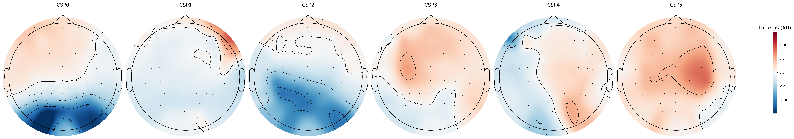
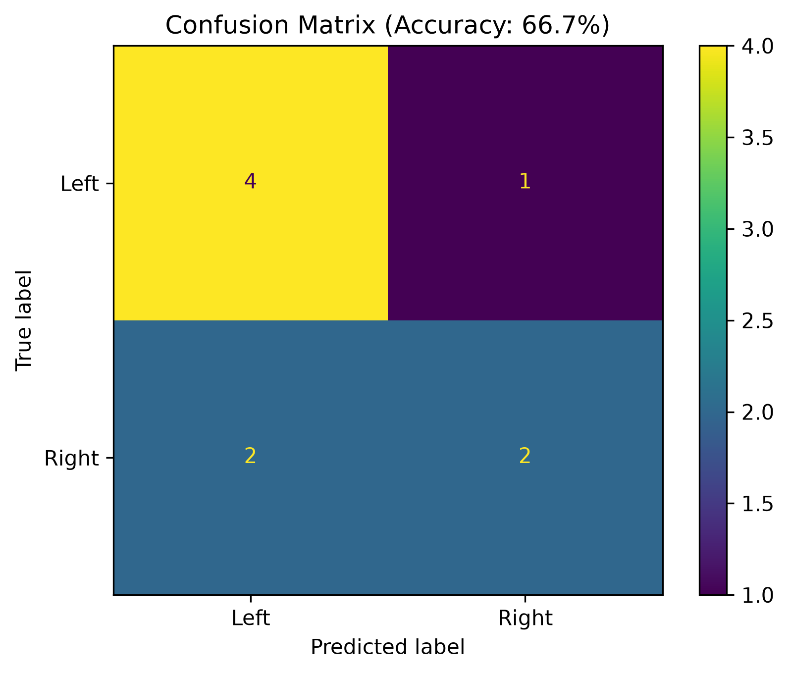

# EEG Motor Imagery Classifier

A machine learning pipeline that classifies imagined left-hand vs. right-hand 
movement from EEG brain signals — a small-scale replica of the core technique 
behind brain-computer interfaces (BCIs) used for paralysis patients and 
prosthetic control.

## What it does

1. Loads EEG recordings from the [PhysioNet EEG Motor Movement/Imagery 
   Dataset](https://physionet.org/content/eegmmidb/1.0.0/)
2. Filters the signal to isolate mu (8-12Hz) and beta (13-30Hz) rhythms — 
   frequency bands known to change during motor imagery
3. Extracts labeled epochs around "imagine left hand" / "imagine right hand" 
   cues
4. Applies Common Spatial Patterns (CSP) to find the electrode combinations 
   that best separate the two classes
5. Trains an SVM classifier and evaluates accuracy

## Results

- **Accuracy:** 66.7% (single subject, 45 total epochs, 80/20 train/test split)
- Baseline (random guess) is 50%, so the model is picking up a real signal — 
  though more data/subjects would be needed for a robust result




## Why this matters

This is the same core pipeline (motor imagery → EEG → spatial filtering → 
classification) underlying real BCIs used to help paralyzed or locked-in 
patients control cursors, wheelchairs, and communication devices using 
imagined movement instead of muscle signals.

## How to run it

```bash
python -m venv venv
source venv/Scripts/activate   # Windows Git Bash
pip install -r requirements.txt
python src/main.py
```

## Tech stack

Python, [MNE-Python](https://mne.tools/) (EEG processing), scikit-learn (CSP + SVM), matplotlib

## Background

Built as a learning project by a 4th-year medical student exploring the 
intersection of clinical neuroscience and software engineering.

## Disclaimer

This is a learning/educational project using pre-recorded public data, not a 
real-time or clinical BCI system.